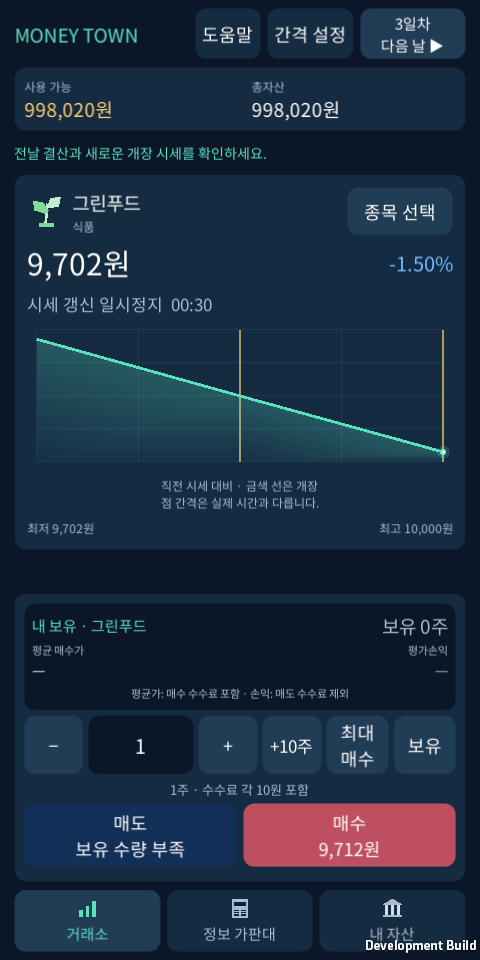
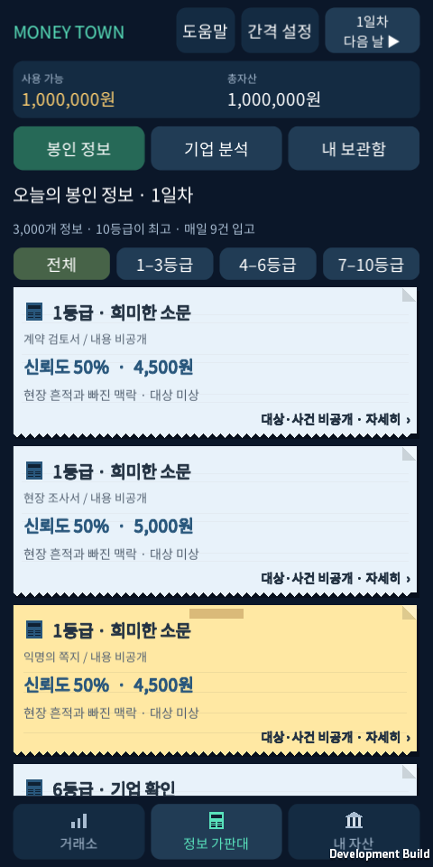
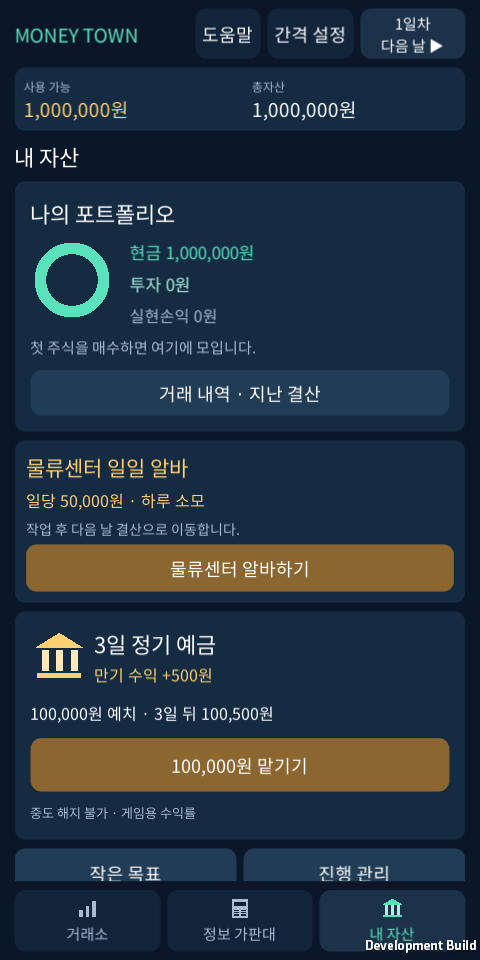
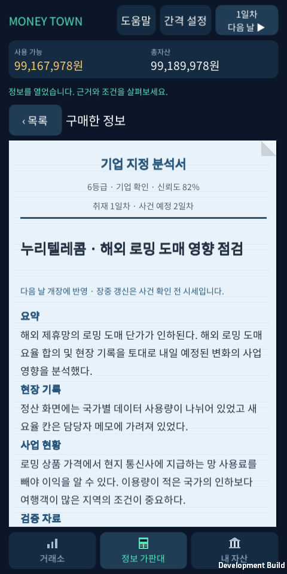
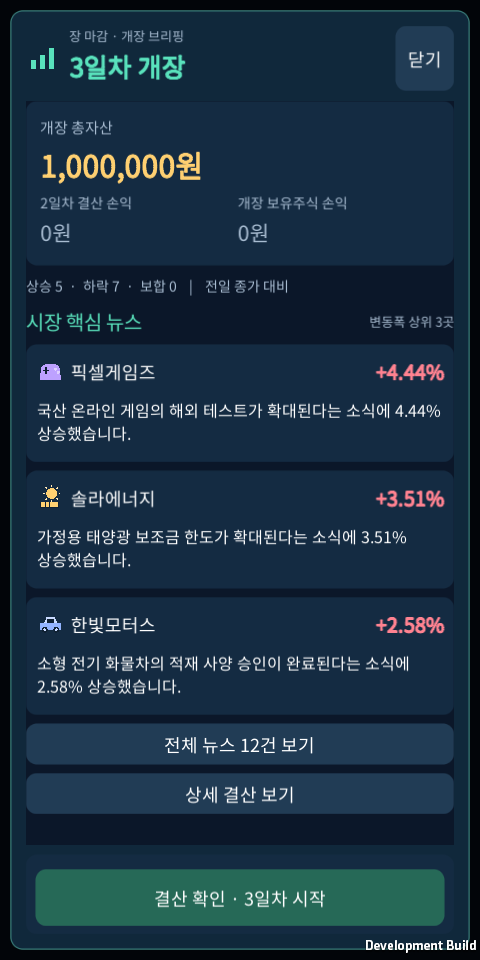
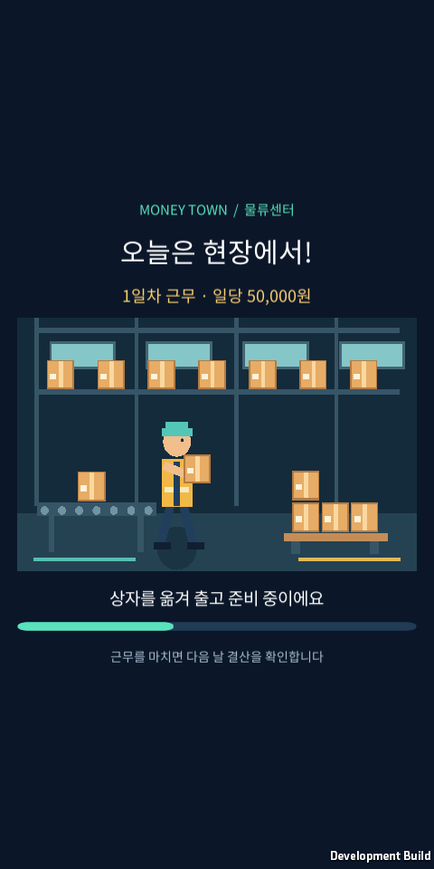

<div align="center">
  
  <p><strong>뉴스 속 단서를 해석하고, 가상 기업에 투자해 자산을 키우는 싱글 플레이 투자 게임.</strong></p>
  <p>
    <a href="#게임-화면">게임 화면</a> ·
    <a href="docs/player-guide.md">플레이 가이드</a> ·
    <a href="docs/development-guide.md">실행·빌드</a> ·
    <a href="docs/README.md">자료실</a> ·
    <a href="docs/roadmap.md">개발 계획</a>
  </p>
</div>

| 12개 가상 기업 | 3,000개 정보 상품 | 10단계 정보 등급 | 50,000원 일당 |
| :---: | :---: | :---: | :---: |
| 업종별 종목을 골라 거래 | 300개 사건 × 10등급 | 가격과 취재 깊이가 다른 단서 | 물류센터에서 다음 투자를 준비 |

## 게임 화면

<table>
  <tr><th align="center">거래소</th><th align="center">정보 가판대</th><th align="center">내 자산</th></tr>
  <tr>
    <td></td>
    <td></td>
    <td></td>
  </tr>
  <tr><td align="center">차트를 보고 거래 수량 선택</td><td align="center">불확실한 단서의 가치를 판단</td><td align="center">자산을 관리하고 다음 투자를 준비</td></tr>
</table>

<table>
  <tr><th align="center">기업 분석</th><th align="center">다음 날 브리핑</th><th align="center">물류센터 알바</th></tr>
  <tr>
    <td></td>
    <td></td>
    <td></td>
  </tr>
  <tr><td align="center">근거와 조건을 읽는 투자</td><td align="center">왜 움직였는지 확인하는 시장</td><td align="center">하루를 써서 다시 마련하는 자금</td></tr>
</table>

2026-10-16, **v0.18.3 Windows 검증용 Unity Player**에서 새로 촬영한 실제 화면입니다. 테스트 데이터를 사용했으며 이미지 보정이나 UI 합성 없이 원본을 제공합니다. Android 실기기 캡처는 아닙니다. [원본 갤러리와 촬영 정보](docs/gallery.md)

## 어떻게 플레이하나요?

**단서를 읽고 → 종목을 고르고 → 거래하고 → 다음 날 결과를 확인합니다.**

‘게임박람회가 열린다’는 정보에서 게임 기업의 기회를 떠올릴 수 있습니다. 다만 정보의 신뢰도, 이미 반영된 가격, 거래 비용까지 판단해야 합니다. 더 비싼 정보는 기업명·사업 지표·조건을 구체적으로 보여 줍니다.

| 선택 | 게임에서 할 수 있는 일 |
| --- | --- |
| 주식 거래 | 12기업의 차트를 보고 매수·매도. 수량 직접 입력, **+10주**, 최대 매수, 보유 수량 선택 |
| 정보 구매 | 매일 무작위 봉인 정보 9건, 기업 지정 분석, 구매한 자료 보관과 후속 보도 |
| 시장 진행 | 30초부터 1시간까지 자동 갱신 간격 선택. 다음 날에는 더 큰 개장 변동과 원인 뉴스 |
| 자산 관리 | 포트폴리오, 거래·결산 기록, 3일 정기 예금, 성장 목표 |
| 다시 시작할 자금 | 현금 제한 없이 물류센터 알바. **일당 50,000원**, 하루 소모 후 결산 |
| 첫 투자 연습 | 본게임 자산과 분리된 10단계 튜토리얼 |

[처음 플레이하는 사람을 위한 가이드](docs/player-guide.md)에서 화면별 조작과 첫 거래를 확인하세요.

## 실행하기

**Unity 6000.3.26f1 / C# / uGUI** 기반입니다. Android가 주 개발 대상이며 Windows 설치형 테스트 버전도 빌드합니다.

1. 저장소를 내려받습니다.

   ```bash
   git clone https://github.com/sanu1227/MoneyTown.git
   ```

2. Unity Hub에서 **`MoneyTown/unity` 폴더**를 프로젝트로 추가합니다.
3. `Assets/Scenes/Main.unity`를 열고 **Play**를 누릅니다. Game 뷰는 세로 비율로 설정합니다.

| 원하는 결과 | 프로젝트 루트의 PowerShell 명령 |
| --- | --- |
| Windows 설치 EXE | `.\Build-Installer.ps1` |
| Android APK | `.\Build-Unity.ps1 -Target Android` |
| Unity 없이 코어 검사 | `dotnet run --project tests/unity-core/UnityCoreChecks.csproj` |

Unity 라이선스·플랫폼 모듈과 각 빌드 도구가 필요합니다. 설치 EXE와 APK는 Git 소스에 포함하지 않습니다. [개발 환경·빌드·설치 가이드](docs/development-guide.md)에 준비물, 결과 경로와 저장 위치를 정리했습니다.

## 개발 자료

| 문서 | 담고 있는 내용 |
| --- | --- |
| [플레이 가이드](docs/player-guide.md) | 처음 시작하기, 거래, 정보 해석, 날짜 진행, 알바 |
| [게임 기획서](docs/game-design.md) | 경제 규칙, 콘텐츠 설계, 화면 기준, 확장 방향 |
| [구조 안내](docs/architecture.md) | Unity UI·게임 규칙·저장·정보 생성 흐름 |
| [정보 자료집](docs/information-catalog/README.md) | 등급별 3,000개 정보, [CSV](docs/information-catalog.csv), [매체별 문체 샘플](docs/information-catalog/style-samples.md) |
| [참고 자료 조사](docs/references.md) | 참고한 게임과 엔진·플랫폼 자료, 조사 당시 적용 아이디어 |
| [개발 계획](docs/roadmap.md) | 구현 완료, 검증할 부분, 향후 확장 후보 |
| [개발 노트](docs/development-log.md) | 날짜별 변경, 결정 이유, 검증과 남은 작업 |

## 현재 상태

**v0.18.3** — ‘+10주’를 누를 때마다 현재 주문 수량이 10주씩 늘어납니다.

| 검증 | 확인 범위 |
| --- | --- |
| Unity 코어 **64개** | 0.18.3 빌드에서 거래·정보·저장·알바 등 규칙 검사 통과 |
| UI **119개 × 2개 화면 크기** | 480×960·360×800 실제 Windows Player 검사 통과. 누적 수량·한도·실제 매수·작은 화면 표시 확인 |
| Windows 설치·업데이트 | 144개 배포 파일 일치, 기존 저장·설정 보존 확인 |
| Android APK | ARM64 빌드 완료. **실제 Android 기기 검증은 진행 전** |

다음 단계는 Android 기기의 터치·안전 영역 확인과 장기 플레이 밸런스 점검입니다. 사업·부동산·채권 등은 [확장 후보](docs/roadmap.md)이며 아직 구현하지 않았습니다.

## 저장소 둘러보기

```text
unity/       현재 Unity 게임 · 씬 · 리소스 · 프로젝트 설정
content/     사건 원안과 매체별 정보 본문
tests/       코어 검사 · 사건 연관성 측정 · 전략 비교
scripts/     정보 생성 · UI 검사 · 설치 검증
packaging/   Windows 설치 프로그램 설정
docs/        기획 · 플레이/개발 가이드 · 개발 노트
assets/      브랜드 배너 · 실제 게임 캡처
android/     이전 Kotlin 구현 보관
prototype/   이전 웹 프로토타입 보관
```

작업은 **변경 → 검증 → 개발 노트 → 한국어 커밋 → GitHub 업로드** 순서로 기록합니다. `main`에서 개발하며 첫 기준 태그는 [`v0.18.2`](https://github.com/sanu1227/MoneyTown/tree/v0.18.2)입니다. [개발 규칙](AGENTS.md)

---

모든 기업과 뉴스는 게임용 창작입니다. 실제 주식 거래·실시간 금융 데이터는 연결하지 않습니다. 포함된 한국어 글꼴의 라이선스는 [SIL Open Font License](unity/Assets/Resources/OFL.txt)를 확인하세요.
