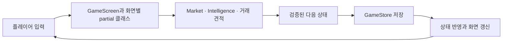

# 코드와 데이터 구조

[첫 화면](../README.md) · [개발·빌드](development-guide.md) · [자료실](README.md)

현재 게임은 **Unity 6.3 LTS / C# / uGUI**로 구성됩니다. 화면은 C#에서 만들고, 경제 규칙과 저장 처리는 `Core`에 모았습니다.

## 플레이 데이터 흐름

UI의 행동 처리는 새 상태를 계산하고 저장이 성공한 뒤 반영합니다. 저장 실패 시 잔액이나 날짜를 먼저 바꾸지 않습니다. 돈과 수량은 정수로 계산하며 거래 한도·잔액·보유량·수수료를 검사합니다.

v0.19.0의 가격 모델 4는 사건·성장·수급의 합과 기존 개장 최소 변동폭을 계산한 뒤 양수만 3배로 늘리고 +12%로 제한합니다. 하락과 장중 규칙은 유지합니다. 조건부 시세 범위도 같은 개장 공식을 사용하며 구매 여부는 시장 가격에 영향을 주지 않습니다. 뉴스의 사건 기여도는 원안 값을 보존하고 상승 확대분은 ‘수급·개장 조정’에 포함합니다.

| 바꾸려는 부분 | 시작할 파일 |
| --- | --- |
| 거래소·자산·주문 영역 | [`GameScreen.cs`](../unity/Assets/Scripts/GameScreen.cs) |
| 자동 갱신·날짜·결산 화면 | [`DayScreen.cs`](../unity/Assets/Scripts/DayScreen.cs) |
| 정보 가판대와 기사 지면 | [`InformationScreen.cs`](../unity/Assets/Scripts/InformationScreen.cs) |
| 물류센터 알바와 애니메이션 | [`WorkScreen.cs`](../unity/Assets/Scripts/WorkScreen.cs) |
| 효과음·버튼·금액·지면의 움직임 | [`GameFeedback.cs`](../unity/Assets/Scripts/GameFeedback.cs) |
| 배경음악 셔플·일시정지·페이드 | [`GameMusic.cs`](../unity/Assets/Scripts/GameMusic.cs) |
| 연출 이벤트 연결·소리와 애니메이션 설정 | [`FeedbackScreen.cs`](../unity/Assets/Scripts/FeedbackScreen.cs) |
| 원본 효과음 생성·파형 검사 | [`generate-sfx.py`](../scripts/generate-sfx.py), [효과음 자료](audio-assets.md) |
| 원곡 배경음악 생성·루프 검사 | [`generate-bgm.py`](../scripts/generate-bgm.py), [음악 자료](music-assets.md) |
| 이야기 해금·확인 순서 | [`Core/Story.cs`](../unity/Assets/Scripts/Core/Story.cs), [`Core/Progress.cs`](../unity/Assets/Scripts/Core/Progress.cs) |
| 이야기 화면·대사·일러스트 연결 | [`StoryScreen.cs`](../unity/Assets/Scripts/StoryScreen.cs), [`StoryChapters.cs`](../unity/Assets/Scripts/StoryChapters.cs), [일러스트 자료](story-art.md) |
| 실제 투자 안내·상단 설명 배너 | [`TutorialScreen.cs`](../unity/Assets/Scripts/TutorialScreen.cs), [`TutorialExplanationScreen.cs`](../unity/Assets/Scripts/TutorialExplanationScreen.cs), [`Core/TutorialGuide.cs`](../unity/Assets/Scripts/Core/TutorialGuide.cs) |
| 차트·아이콘·종이 표현 | [`PriceChart.cs`](../unity/Assets/Scripts/PriceChart.cs), [`MarketIcon.cs`](../unity/Assets/Scripts/MarketIcon.cs), [`PaperSheet.cs`](../unity/Assets/Scripts/PaperSheet.cs) |
| 거래·가격·날짜 규칙 | [`Core/Market.cs`](../unity/Assets/Scripts/Core/Market.cs), [`Core/TradingDay.cs`](../unity/Assets/Scripts/Core/TradingDay.cs) |
| 주문 가능 여부와 최대 매수 | [`Core/OrderGuidance.cs`](../unity/Assets/Scripts/Core/OrderGuidance.cs) |
| 정보 생성·구매·본문 | [`Core/Intelligence.cs`](../unity/Assets/Scripts/Core/Intelligence.cs), [`Core/InfoMarket.cs`](../unity/Assets/Scripts/Core/InfoMarket.cs), [`Core/ClueContent.cs`](../unity/Assets/Scripts/Core/ClueContent.cs) |
| 저장과 백업 | [`Core/GameStore.cs`](../unity/Assets/Scripts/Core/GameStore.cs) |
| 자동 UI 검사와 촬영 | [`VerificationScreen.cs`](../unity/Assets/Scripts/VerificationScreen.cs), [`StoryVerificationScreen.cs`](../unity/Assets/Scripts/StoryVerificationScreen.cs) |

v0.21.0의 `GameFeedback`은 `Resources/Audio`의 효과음 8종을 2D `AudioSource`로 재생하고 `RectTransform`·`CanvasGroup`으로 눌림·크기 강조·등장 움직임을 처리합니다. 연속 입력은 소리를 중첩하지 않고 최근 소리로 바꿉니다. `FeedbackScreen`은 버튼·행동 결과·지면·시세 이벤트와 설정을 연결하며 경제 상태를 계산하지 않습니다.

효과음 켜기/끄기, 음량 0·25·50·75·100%(기본 50%), 동작 줄이기는 `GameRuntime`을 통해 기기 설정에 저장합니다. 게임 진행 파일과 별개입니다. 동작 줄이기는 화면 움직임을 중단하고 알바를 정지 장면으로 표시하지만 기존 약 4.2초 작업 흐름과 보상 규칙은 유지합니다. 앱 비활성화 때는 소리와 진행 중인 움직임을 멈춥니다.

v0.24.0의 `GameMusic`은 `Resources/Audio`의 원곡 4곡을 PCM 스트리밍으로 읽어 별도 2D `AudioSource`에서 재생합니다. 독립 `System.Random`으로 Fisher–Yates 셔플을 수행해 한 바퀴마다 모든 곡을 한 번씩 재생하고, 다음 바퀴 첫 곡이 직전 곡과 같으면 순서를 교환합니다. 시장·사건 난수와 Unity 전역 난수를 사용하지 않습니다. 곡 종료와 수동 `NextTrack()` 모두 같은 순서를 소비합니다. `SelectTrack(int)`는 원하는 곡을 직접 선택합니다. 남은 순서에 있으면 그 곡만 앞으로 옮겨 소비하고 나머지 대기곡은 보존합니다. 이미 재생한 곡의 명시적 재선택도 허용하며, 현재 곡과 잘못된 번호는 무시합니다. `GetTrackTitle(int)`는 목록용 제목을 제공합니다.

메뉴 전환과 효과음 재생은 음악의 재생 위치를 바꾸지 않습니다. 초기에는 중단 상태로 생성하고 저장한 설정을 적용한 뒤 재생합니다. 꺼짐·0음량·앱 비활성화 때 일시정지하며, 복귀하면 같은 곡의 같은 위치에서 0.5초 페이드인합니다. 자연 종료 전에는 짧은 페이드아웃을 적용합니다. 중단 상태에서 다음 곡을 골라도 자동으로 켜지지 않습니다.

배경음악은 기본 켜짐·25%이고 0·25·50·75·100%를 선택합니다. `FeedbackScreen`이 배경음악 카드를 효과음 카드 앞에 배치하고 `MoneyTown.Music.Enabled`·`MoneyTown.Music.Volume` 설정을 저장합니다. 음악·효과음의 AudioSource와 설정을 분리해 각각 음량을 조절하며 동작 줄이기는 음악 재생에 영향을 주지 않습니다.

## 이야기 진행과 화면 순서

`Story`는 프롤로그와 총자산 200만원·1천만원·1억원·10억원·100억원의 장을 관리합니다. `Progress.Record`가 현금·주식 평가액·예금 원금을 합산해 `StoryUnlocked`를 늘리고, 자산 하락에도 해금 기록을 유지합니다. `StorySeen`은 확인한 장 수입니다. `Next`는 가장 앞의 미확인 장을 반환하고 `Acknowledge`는 그 장만 확인한 복사본을 만듭니다. 여러 구간을 넘으면 순서대로 이어집니다.

`StoryScreen`은 새 게임의 도입부를 튜토리얼보다 먼저 표시합니다. 성장 장면은 미확인 결산·물류센터 작업·튜토리얼이 끝난 뒤 표시하며 설정·도움말에서는 기다립니다. 이야기 중 일반 화면을 숨기고 거래·날짜·시세 갱신을 막습니다.

0.30.0은 도입부를 끝내거나 건너뛰면 실제 거래소에서 첫 투자 안내를 시작합니다. `FinishStory`가 이야기 확인 진도와 안내 시작을 같은 저장에 반영하며 실패하면 이야기 화면을 유지합니다. 재감상과 성장 장면은 안내를 새로 시작하지 않습니다.

`TutorialGuide`는 별도 시장을 만들지 않고 `GameState`의 활성 여부·단계·선택 기업·정보 번호·정보 날짜만 관리합니다. `TutorialScreen`은 기존 거래소·정보 가판대·자산 화면을 그대로 표시하고 상단 안내 배너와 실제 버튼의 금빛 테두리를 추가합니다. 현재 단계의 버튼·스크롤·설명 접기와 펼치기·안내 중단을 허용하며 자동 시세와 성장 이야기는 기다립니다. 다음 날과 결산은 실제 시장 규칙대로 진행합니다. 예금 가입은 선택할 수 있습니다.

v0.31.0은 중앙 설명창을 확인한 뒤 실제 행동을 수행하는 방식이었습니다. v0.32.0의 `TutorialExplanationScreen`은 기존 `guideBanner` 안에 개념·현재 상황과 금액·할 일을 함께 표시합니다. 별도 ‘직접 해보기’ 확인 없이 강조된 실제 버튼을 바로 사용할 수 있습니다. 수수료 포함 견적, 정보 구매비와 이미 보유한 자료 여부, 날짜·개장 변동, 최근 매도 손익·예금 만기는 현재 게임 상태에서 읽습니다. 아직 받지 않은 예금 반환금을 지급 완료로 표현하지 않습니다.

v0.32.0은 중앙 오버레이와 설명을 읽는 동안의 `CanvasGroup` 전체 입력 차단을 사용하지 않습니다. 현재 단계에 맞는 행동만 허용하는 기존 가드는 유지합니다. ‘설명 접기’·‘설명 펼치기’는 자산·날짜·안내 진도를 바꾸거나 저장하지 않습니다. 접힘 상태는 실행 중에만 유지하고, 다음 단계·앱 재실행·안내 이어하기·처음부터 시작 시 설명을 펼쳐 표시합니다. 저장 실패는 같은 단계에 남으며 배너 안에 재시도 안내를 표시합니다.

금액 행동은 `Act`에서 실제 변경본에 `TutorialGuide.Record`로 진도를 기록한 뒤 한 번 저장합니다. 결산 확인도 같은 순서를 사용합니다. 탭 이동·기업 선택 같은 안내 행동도 저장 성공 후 화면을 바꿉니다. 복원은 이미 저장된 상태만 표시하며 거래를 재실행하지 않습니다. 안내를 중단해도 자산과 거래는 유지되고, 중단 중 구매·매도·결산 확인·예금 가입을 마쳤다면 이어하기에서 이를 반영합니다. 판매가 끝난 미구매 정보는 현재 자료를 다시 고르게 합니다.

저장 형식 13은 형식 12 본문 뒤에 안내 필드 21바이트를 추가합니다. v0.31.0의 설명창과 v0.32.0의 상단 설명 배너는 저장 필드를 추가하지 않으며 형식 13을 유지합니다. 기존 형식 1~12는 안내 비활성으로 읽습니다. `GameStore.LoadedVersion`이 구형 파일이고 이전 v2 연습이 진행 중이었다면 새 안내 첫 단계로 전환합니다. 완료·건너뜀 기록은 강제로 다시 시작하지 않습니다. `RestoreTutorial`을 이야기 해금 저장보다 먼저 호출해 원본 버전을 확인합니다.

v0.28.0은 프롤로그 첫 페이지의 v0.27.1 중앙 자막 화면을 유지합니다. `StoryArt/00-beginning` 배경과 `BuildStoryOpening`·`UpdateStoryOpening`의 연출을 사용합니다. “이건 내가 / 세계 최고의 부자가 / 되는 이야기이다”를 세 줄로 나누고 가운데 줄을 48 크기의 금빛, 나머지를 30 크기로 표시합니다. 각 줄은 0.2·1.0·1.8초부터 0.8초 동안 나타나며, 2.4~3.8초에 암전을 걷어 기존 일러스트를 보여 줍니다. 연출 중 버튼은 현재 화면을 완성하고, 완성 후 버튼은 두 번째 페이지로 이동합니다.

나머지 17페이지는 각각 `StoryArt/Comic/<ArtName>-pNN` 리소스를 읽습니다. `NN`은 장 안의 페이지를 1부터 두 자리로 표시한 값입니다. 프롤로그는 p02·p03, 이후 다섯 장은 p01~p03을 사용합니다. 각 1024×1536 PNG는 위아래에 별도로 그린 장면 두 개를 담으며, 두 `RawImage`는 같은 페이지 텍스처의 서로 겹치지 않는 반쪽을 표시합니다. `CropStoryPanel`이 가운데 경계에서 최소 4px 안쪽의 UV를 구하고 각 컷의 가로세로 비율에 맞게 자릅니다. 같은 장의 그림 한 장을 확대해 반복하던 방식은 사용하지 않습니다. 첫 멘트 배경은 기존 `CropStoryIllustration`을 사용합니다.

아이보리 지면과 검은 테두리, 사각 캡션과 흰 말풍선은 uGUI로 구성하며 한국어 문장은 별도 `Text`로 유지합니다. 첫 컷은 0~0.25초, 둘째 컷은 0.15~0.4초 동안 투명도와 크기 0.975~1을 바꾼 뒤 정지합니다. 만화 페이지는 클릭 한 번으로 다음 페이지로 이동합니다. 장 제목·해금 기준·페이지 번호는 위쪽에, 진행·건너뛰기·오류 안내는 아래쪽에 둡니다.

두 방식 모두 Unity 시작 로고가 끝난 뒤 연출을 진행하고 앱 비활성화 때 연출 시간을 멈춥니다. 동작 줄이기에서는 완성된 정지 화면을 즉시 표시합니다. 자동 페이지 넘김은 없으며 이야기 해금과 저장 규칙은 유지합니다.

내레이션 재생 클래스·음원·원본 생성 도구와 전용 음악 감쇠 처리는 제거했습니다. 기존 `GameMusic`과 `GameFeedback`의 배경음악·일반 효과음은 계속 사용합니다. 이전 구현은 [v0.26.1 코드 구조](https://github.com/sanu1227/MoneyTown/blob/v0.26.1/docs/architecture.md)와 [음원 보관 안내](opening-audio.md)에 남깁니다.

마지막 페이지와 건너뛰기는 현재 자산의 해금 상태를 다시 계산하고 확인 진도를 저장한 뒤 창을 닫습니다. 저장 실패 시 현재 장과 페이지를 유지해 재시도할 수 있습니다. 초기 해금 저장이 실패했더라도 확인 저장의 재시도에서 해금을 함께 반영합니다. 페이지 단위로 저장하지 않으므로 중간 종료 후에는 해당 장 처음부터 이어집니다. 도움말의 다시 보기는 저장을 바꾸지 않습니다. [장 구성과 대사 관리](story.md)

## 정보 콘텐츠 흐름

```mermaid
flowchart TD
    Sources[content의 사건·취재·대화 원안] --> Generator[build_information_catalog.py]
    Generator --> Runtime[Unity Resources의 게임 카탈로그]
    Generator --> Docs[등급별 Markdown과 CSV]
    Runtime --> Reader[InformationCatalog와 ClueContent]
    Reader --> Paper[정보 가판대와 기사 화면]
    Sources --> Checks[test_information_catalog.py]
    Runtime --> Checks
    Docs --> Checks
```

300개 사건 원안을 10등급의 취재 깊이로 구성해 3,000개 정보 상품을 제공합니다. 이전에 산 자료의 문구가 바뀌지 않도록 과거 카탈로그 판본도 보존합니다. 콘텐츠 수정 절차는 [개발 가이드](development-guide.md#정보-콘텐츠-수정)를 참고하세요.

## 진행 보호와 검증

- 저장은 체크섬·임시 파일 교체·백업을 사용합니다. v0.20.1의 형식 11은 현재 날짜의 가격 모델과 가격 기준 조정 내역을 기록했습니다. v0.25.0의 형식 **12**는 그 본문 뒤에 `StoryUnlocked`·`StorySeen` 두 정수를 추가합니다. v0.30.0의 현재 형식 **13**은 실제 플레이 안내의 상태·단계·대상을 덧붙입니다.
- `SaveCodec.Decode`는 이전 기록을 복원합니다. `GameStore.Load`는 형식 1~10을 `PriceMigration.Apply`로 한 번 환산하고 원본 사본을 보관한 뒤 원자적으로 저장합니다. 총자산은 그대로이며 정수 주식으로 바꾸고 남는 금액만 현금으로 정산합니다. 미리보기에서는 파일을 바꾸지 않습니다.
- 형식 11~13은 가격 환산 대상이 아닙니다. 형식 1~11의 이야기 기본값은 해금 1장·확인 0장이며, 디코딩 단계에서 자산에 따라 해금하지 않습니다. 화면 시작·복구 시 현재 자산으로 추가 해금을 계산해 저장하고, 과거 최고자산은 추정하지 않습니다. `Market.Validate`·`Story.Validate`는 이야기 필드를 수정하지 않습니다.
- 저장 형식 1~9의 현재 날짜는 가격 모델 3으로 읽습니다. 다음 개장 한 번은 기존 규칙을 적용하고, 이후 생성되는 날짜부터 모델 4를 사용합니다. 새 게임은 모델 4로 시작합니다. 이전 구매본의 가격 모델·본문·시세 범위와 과거 결산은 보존합니다.
- 미확인 결산을 저장하므로 앱을 다시 열어도 결산 확인부터 이어갑니다.
- `GameRuntime.Verifying`은 검증 전용 데이터 경로와 별도 설정을 사용합니다. 검증 앱은 본게임 저장을 건드리지 않습니다.
- 코어 검사는 Unity와 .NET에서 같은 C# 규칙을 사용합니다. UI 검사는 별도 Unity Player에서 실제 콜백과 렌더링을 확인합니다.
- `android/`와 `prototype/`은 이전 구현 보관용이며 현재 주 개발 대상은 `unity/`입니다.
