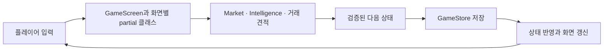
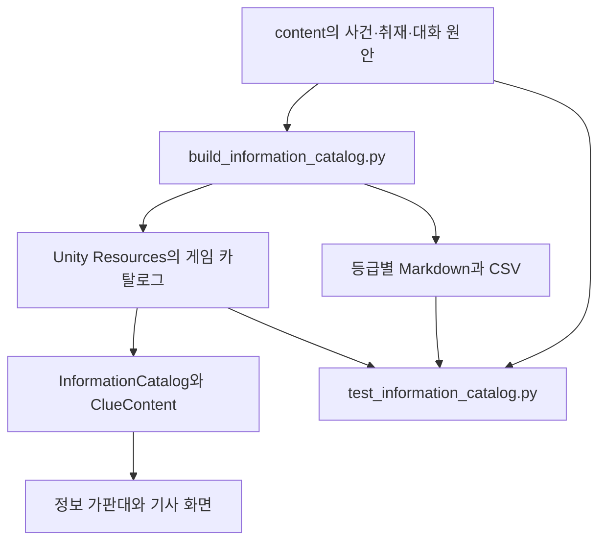

# 코드와 데이터 구조

[첫 화면](../README.md) · [개발·빌드](development-guide.md) · [자료실](README.md)

현재 게임은 **Unity 6.3 LTS / C# / uGUI**로 구성됩니다. 화면은 C#에서 만들고, 경제 규칙과 저장 처리는 `Core`에 모았습니다.

## 플레이 데이터 흐름

UI의 행동 처리는 새 상태를 계산하고 저장이 성공한 뒤 반영합니다. 저장 실패 시 잔액이나 날짜를 먼저 바꾸지 않습니다. 돈과 수량은 정수로 계산하며 거래 한도·잔액·보유량·수수료를 검사합니다.

v0.19.0의 가격 모델 4는 사건·성장·수급의 합과 기존 개장 최소 변동폭을 계산한 뒤 양수만 3배로 늘리고 +12%로 제한합니다. 하락과 장중 규칙은 유지합니다. 조건부 시세 범위도 같은 개장 공식을 사용하며 구매 여부는 시장 가격에 영향을 주지 않습니다. 뉴스의 사건 기여도는 원안 값을 보존하고 상승 확대분은 ‘수급·개장 조정’에 포함합니다.

| 바꾸려는 부분 | 시작할 파일 |
| --- | --- |
| 거래소·자산·주문 영역 | [`GameScreen.cs`](../unity/Assets/Scripts/GameScreen.cs) |
| 자동 갱신·날짜·결산 화면 | [`DayScreen.cs`](../unity/Assets/Scripts/DayScreen.cs) |
| 정보 가판대와 기사 지면 | [`InformationScreen.cs`](../unity/Assets/Scripts/InformationScreen.cs) |
| 물류센터 알바와 애니메이션 | [`WorkScreen.cs`](../unity/Assets/Scripts/WorkScreen.cs) |
| 효과음·버튼·금액·지면의 움직임 | [`GameFeedback.cs`](../unity/Assets/Scripts/GameFeedback.cs) |
| 배경음악 반복·일시정지·페이드 | [`GameMusic.cs`](../unity/Assets/Scripts/GameMusic.cs) |
| 연출 이벤트 연결·소리와 애니메이션 설정 | [`FeedbackScreen.cs`](../unity/Assets/Scripts/FeedbackScreen.cs) |
| 원본 효과음 생성·파형 검사 | [`generate-sfx.py`](../scripts/generate-sfx.py), [효과음 자료](audio-assets.md) |
| 원곡 배경음악 생성·루프 검사 | [`generate-bgm.py`](../scripts/generate-bgm.py), [음악 자료](music-assets.md) |
| 차트·아이콘·종이 표현 | [`PriceChart.cs`](../unity/Assets/Scripts/PriceChart.cs), [`MarketIcon.cs`](../unity/Assets/Scripts/MarketIcon.cs), [`PaperSheet.cs`](../unity/Assets/Scripts/PaperSheet.cs) |
| 거래·가격·날짜 규칙 | [`Core/Market.cs`](../unity/Assets/Scripts/Core/Market.cs), [`Core/TradingDay.cs`](../unity/Assets/Scripts/Core/TradingDay.cs) |
| 주문 가능 여부와 최대 매수 | [`Core/OrderGuidance.cs`](../unity/Assets/Scripts/Core/OrderGuidance.cs) |
| 정보 생성·구매·본문 | [`Core/Intelligence.cs`](../unity/Assets/Scripts/Core/Intelligence.cs), [`Core/InfoMarket.cs`](../unity/Assets/Scripts/Core/InfoMarket.cs), [`Core/ClueContent.cs`](../unity/Assets/Scripts/Core/ClueContent.cs) |
| 저장과 백업 | [`Core/GameStore.cs`](../unity/Assets/Scripts/Core/GameStore.cs) |
| 자동 UI 검사와 촬영 | [`VerificationScreen.cs`](../unity/Assets/Scripts/VerificationScreen.cs) |

v0.21.0의 `GameFeedback`은 `Resources/Audio`의 효과음 8종을 2D `AudioSource`로 재생하고 `RectTransform`·`CanvasGroup`으로 눌림·크기 강조·등장 움직임을 처리합니다. 연속 입력은 소리를 중첩하지 않고 최근 소리로 바꿉니다. `FeedbackScreen`은 버튼·행동 결과·지면·시세 이벤트와 설정을 연결하며 경제 상태를 계산하지 않습니다.

효과음 켜기/끄기, 음량 0·25·50·75·100%(기본 50%), 동작 줄이기는 `GameRuntime`을 통해 기기 설정에 저장합니다. 게임 저장 형식 11과 별개입니다. 동작 줄이기는 화면 움직임을 중단하고 알바를 정지 장면으로 표시하지만 기존 약 4.2초 작업 흐름과 보상 규칙은 유지합니다. 앱 비활성화 때는 소리와 진행 중인 움직임을 멈춥니다.

v0.22.0의 `GameMusic`은 `Resources/Audio/town-lounge`의 원곡을 PCM 스트리밍으로 읽어 별도 2D `AudioSource`에서 반복합니다. 메뉴 전환과 효과음 재생은 음악의 재생 위치를 바꾸지 않습니다. 초기에는 중단 상태로 생성하고 저장한 설정을 적용한 뒤 재생합니다. 꺼짐·0음량·앱 비활성화 때 일시정지하며, 복귀하면 같은 위치에서 0.5초 페이드인합니다. 오브젝트 비활성화로 네이티브 오디오가 멈춘 경우에도 재생 위치를 복원합니다.

배경음악은 기본 켜짐·25%이고 0·25·50·75·100%를 선택합니다. `FeedbackScreen`이 배경음악 카드를 효과음 카드 앞에 배치하고 `MoneyTown.Music.Enabled`·`MoneyTown.Music.Volume` 설정을 저장합니다. 음악·효과음의 AudioSource와 설정을 분리해 각각 음량을 조절하며 동작 줄이기는 음악 재생에 영향을 주지 않습니다.

## 정보 콘텐츠 흐름

300개 사건 원안을 10등급의 취재 깊이로 구성해 3,000개 정보 상품을 제공합니다. 이전에 산 자료의 문구가 바뀌지 않도록 과거 카탈로그 판본도 보존합니다. 콘텐츠 수정 절차는 [개발 가이드](development-guide.md#정보-콘텐츠-수정)를 참고하세요.

## 진행 보호와 검증

- 저장은 체크섬·임시 파일 교체·백업을 사용합니다. v0.20.1의 내부 저장 형식은 11이며 현재 날짜의 가격 모델과 가격 기준 조정 내역을 기록합니다.
- `SaveCodec.Decode`는 이전 기록을 복원합니다. `GameStore.Load`는 형식 1~10을 `PriceMigration.Apply`로 한 번 환산하고 원본 사본을 보관한 뒤 원자적으로 저장합니다. 총자산은 그대로이며 정수 주식으로 바꾸고 남는 금액만 현금으로 정산합니다. 미리보기에서는 파일을 바꾸지 않습니다.
- 저장 형식 1~9의 현재 날짜는 가격 모델 3으로 읽습니다. 다음 개장 한 번은 기존 규칙을 적용하고, 이후 생성되는 날짜부터 모델 4를 사용합니다. 새 게임은 모델 4로 시작합니다. 이전 구매본의 가격 모델·본문·시세 범위와 과거 결산은 보존합니다.
- 미확인 결산을 저장하므로 앱을 다시 열어도 결산 확인부터 이어갑니다.
- `GameRuntime.Verifying`은 검증 전용 데이터 경로와 별도 설정을 사용합니다. 검증 앱은 본게임 저장을 건드리지 않습니다.
- 코어 검사는 Unity와 .NET에서 같은 C# 규칙을 사용합니다. UI 검사는 별도 Unity Player에서 실제 콜백과 렌더링을 확인합니다.
- `android/`와 `prototype/`은 이전 구현 보관용이며 현재 주 개발 대상은 `unity/`입니다.
