# 실제 게임 화면

[첫 화면](../README.md) · [플레이 가이드](player-guide.md) · [자료실](README.md)

<strong>v0.28.0 장면별 새 일러스트 — 17페이지·34장면</strong>

첫 멘트는 기존 중앙 자막과 배경을 유지합니다. 이후에는 페이지와 상하 컷마다 다른 장면이 나옵니다. 시작 자금, 기사 분석, 도시의 일터, 동료의 의견을 대사에 맞춰 그렸습니다. [장면별 원본·프롬프트·해시](story-art.md)

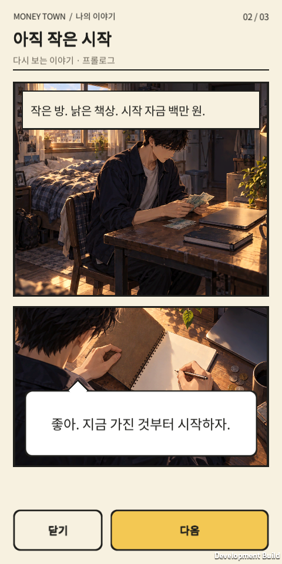
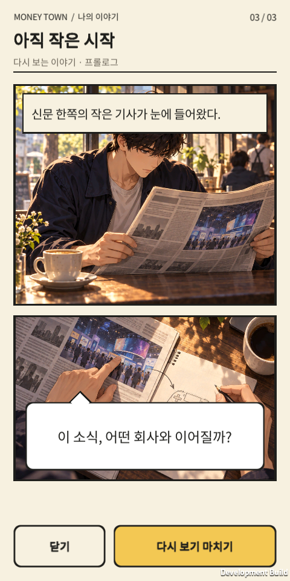
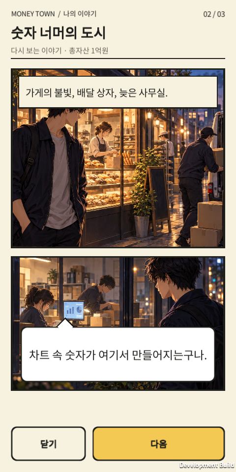
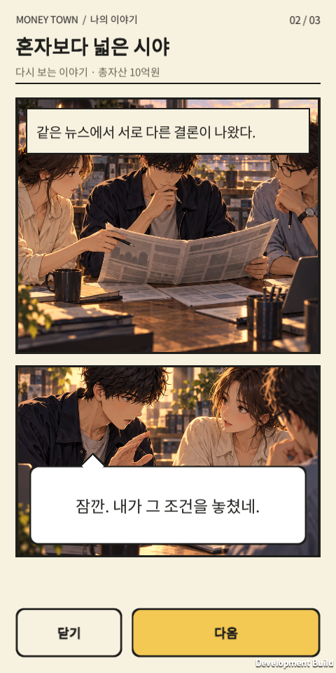

2026-10-16, 격리 Windows 검증용 Unity Player의 480×960 화면을 촬영했습니다. 원본은 `build/ui-verification-6e58baddf87548bca019fb87368b1643/`의 42·43·51·54번 PNG이며 공개 이미지와 각각 SHA-256이 같습니다. 전체 18페이지를 캡처해 확인했고 480×960·360×800에서 각각 UI 279개를 통과했습니다. 첫 화면의 32번 캡처는 v0.27.1 검사 원본과 바이트가 같습니다. 이미지 보정·UI 합성 없이 제공하며 Android 실기기 캡처는 아닙니다.

<strong>v0.27.1 첫 멘트 중앙 자막 복원 — 이후 카툰 유지</strong>

‘이건 내가 / 세계 최고의 부자가 / 되는 이야기이다’가 중앙에 순서대로 나타나고 도시 배경을 드러냅니다. ‘문장 바로 보기’로 연출을 완성한 뒤 ‘이야기 시작’을 누르면 두 컷 만화로 이어집니다. 내레이션은 재생하지 않습니다. [스토리 구성과 조작](story.md)

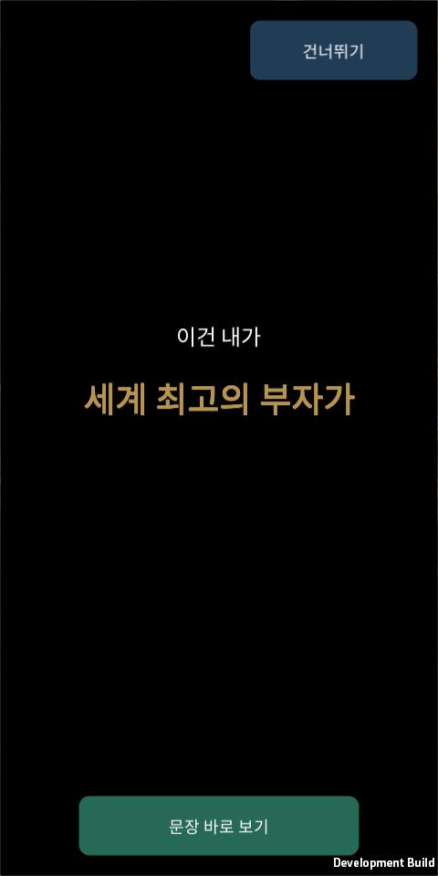
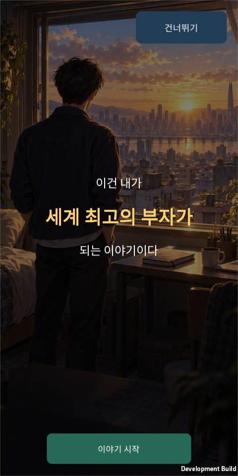

2026-10-16, 격리된 테스트 데이터의 Windows 검증용 Unity Player에서 촬영했습니다. 원본은 `build/ui-verification-c630f51c8bb947898339290cdce97f9e/`의 40·38·39번 PNG입니다. 480×960·360×800에서 각각 UI 277개를 통과했고, 공개 이미지 3개의 SHA-256은 각각 원본과 같습니다. 이미지 보정이나 UI 합성은 하지 않았습니다. Android 실기기 캡처는 아닙니다.

<strong>v0.27.0 카툰 스토리 — 두 컷과 말풍선</strong>

아이보리 지면에 장면 컷과 확대 컷을 배치하고, 상황 캡션과 주인공의 짧은 독백을 나눴습니다. 내레이션은 제거했으며 배경음악과 일반 효과음은 유지합니다. 첫 페이지부터 ‘다음’을 한 번 누르면 넘어갑니다. [스토리 구성과 조작](story.md)

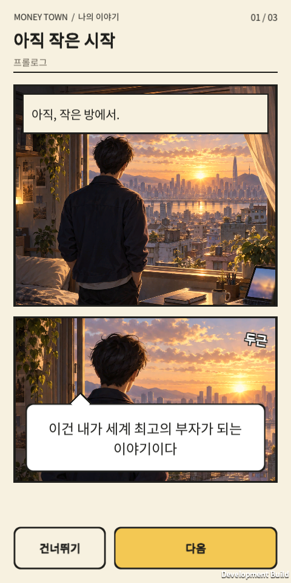
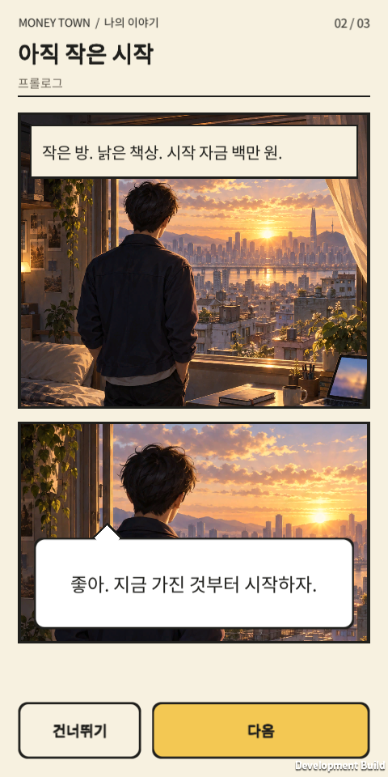
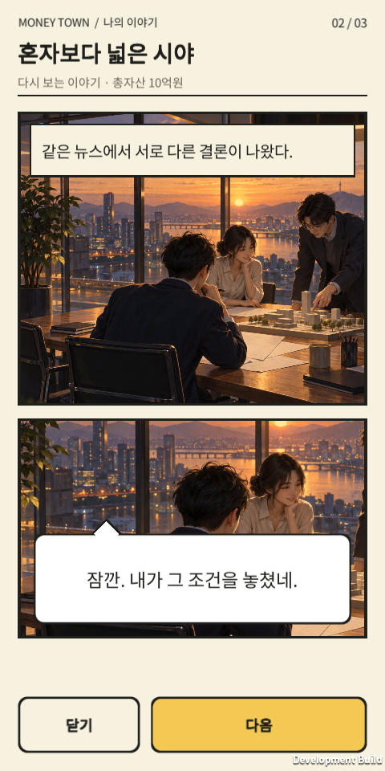

2026-10-16, 격리된 테스트 데이터의 Windows 검증용 Unity Player에서 촬영했습니다. 원본은 `build/ui-verification-1d7f1dfc37f843e196f5561dac8485ae/`의 35·36·37번 PNG입니다. 480×960·360×800에서 각각 UI 267개를 통과했고, 공개 이미지 3개의 SHA-256은 각각 원본과 같습니다. 이미지 보정이나 UI 합성은 하지 않았습니다.

**과거 v0.26.1 음성 개선 (0.27.0에서 제거):** 오프닝 목소리를 무료 로컬 신경망 남성 음성으로 교체했습니다. 화면 구성은 유지하고 새 음성에 맞춰 문구 타이밍을 조정했습니다. [당시 내레이션](https://github.com/sanu1227/MoneyTown/blob/v0.26.1/unity/Assets/Resources/Audio/story-opening.wav) · [제작·검증 자료](opening-audio.md)

**2026-10-16 촬영.** 내레이션 설정은 v0.26.0, 첫 문장 연출은 v0.25.1, 성장 스토리는 v0.25.0, 곡 직접 선택은 v0.24.0, 음악 랜덤 재생은 v0.23.0, 이전 음악 설정은 v0.22.0, 효과음 설정은 v0.21.0, 가격 조정 내역은 v0.20.1, 기본 화면은 v0.20.0입니다. 각 항목을 펼치면 480×960 원본을 볼 수 있습니다. Windows 검증용 Unity Player에서 테스트 데이터로 실행한 화면이며 이미지 보정이나 UI 합성 없이 제공합니다.

<strong>v0.26.0 무료 내레이션 — 첫 문장에 목소리와 효과음</strong>

Windows 한국어 음성과 직접 합성한 울림·차임으로 도입부를 들려줍니다. 재생 중 배경음악은 잠시 작아지며, 효과음과 내레이션의 켜기·끄기·음량 설정을 함께 사용합니다. [당시 음원](https://github.com/sanu1227/MoneyTown/blob/v0.26.0/unity/Assets/Resources/Audio/story-opening.wav) · [제작 과정](opening-audio.md)

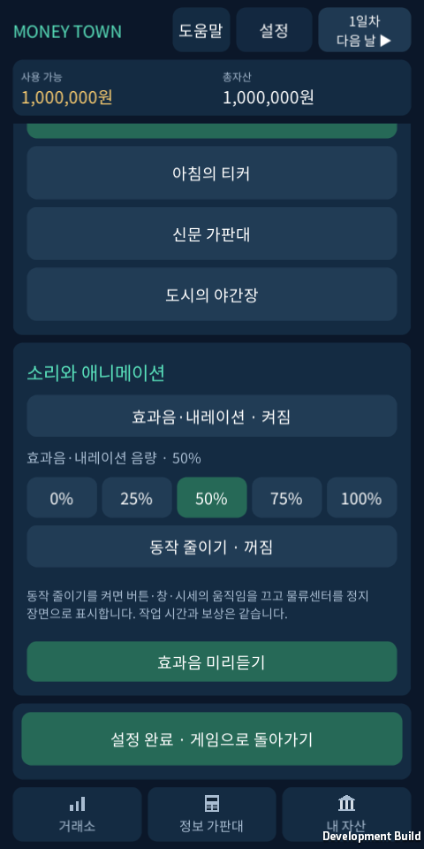

원본은 `build/ui-verification-85fae8586ca24d8f819bd6307c4bb61e/28-feedback-settings.png`입니다. 480×960·360×800에서 각각 UI 274개를 통과했고 공개 이미지 SHA-256은 원본과 같습니다. 실제 스피커 청취와 Android 실기기 검증은 별도로 남아 있습니다.

<strong>v0.25.1 첫 문장 — 금빛 타이틀과 도시의 등장</strong>

어두운 화면에 첫 문장이 세 줄로 차례로 나타난 뒤 도시 배경을 드러냅니다. ‘문장 바로 보기’는 연출을 즉시 완성하고, ‘이야기 시작’은 다음 대사로 넘어갑니다. 도움말에서 프롤로그를 다시 보면 같은 연출을 감상할 수 있습니다.

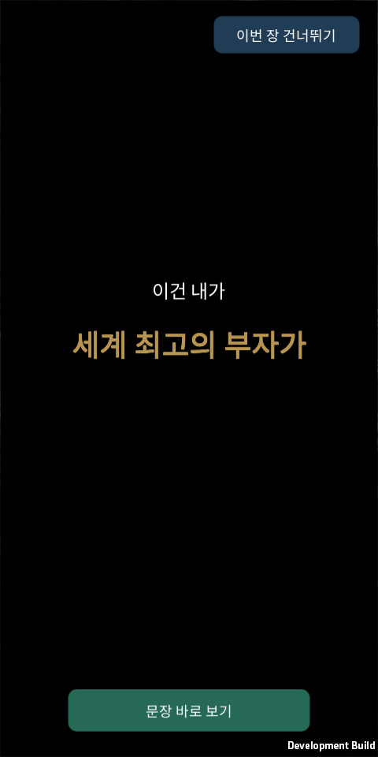
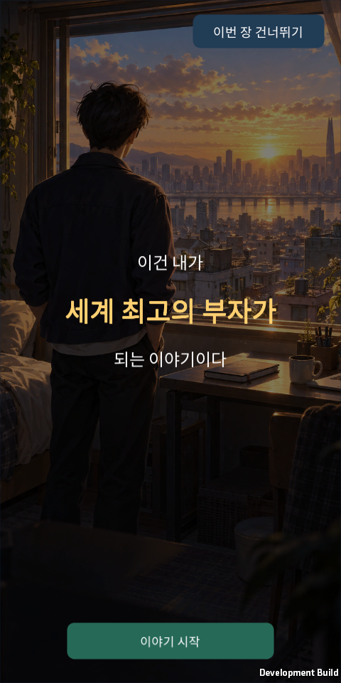

원본은 `build/ui-verification-b8aa6d9a92f34945a6f0ee9eb794b2e9/`의 `36-story-opening-dark.png`, `35-story-opening.png`입니다. 480×960·360×800에서 각각 UI 266개 검사를 통과했으며 공개 이미지 2개의 SHA-256이 각각 원본과 같습니다.

<strong>v0.25.0 성장 이야기 — 작은 방에서 더 넓은 세상으로</strong>

도입부와 총자산 200만원·1천만원·1억원·10억원·100억원에 열리는 이야기입니다. 장마다 전용 일러스트를 천천히 움직이고 본문을 부드럽게 표시합니다. 도움말의 ‘나의 이야기’에서 해금한 장을 다시 감상할 수 있습니다. [이야기 구성](story.md) · [일러스트 원본과 제작 자료](story-art.md)

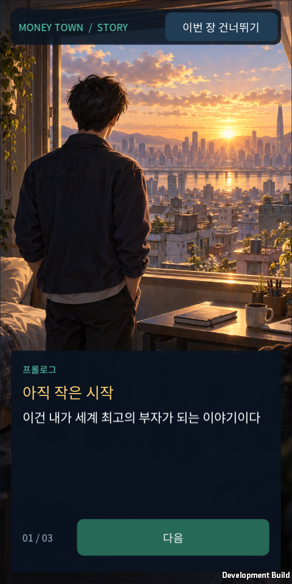
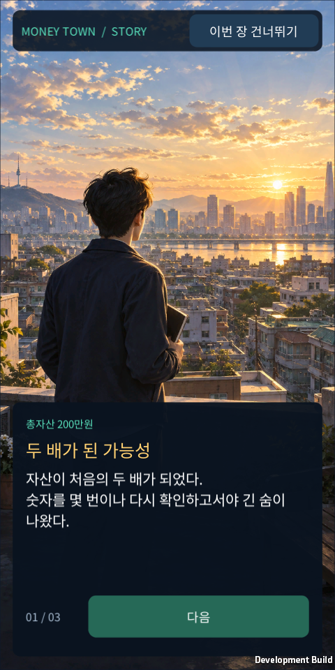
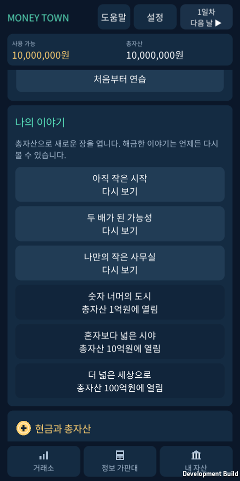

원본은 `build/ui-verification-0962a6d5914c4a3fb4062eff3215d7fa/`의 `32-story-intro.png`, `33-story-milestone.png`, `34-story-library.png`입니다. UI 256개 검사를 통과한 실제 Player 캡처이며 공개 이미지 3개의 SHA-256이 각각 원본과 같습니다. 360×800에서도 256개 검사와 글자 배치를 확인했습니다.

<strong>v0.24.0 배경음악 — 원하는 곡 직접 선택</strong>

설정의 배경음악 아래에서 네 곡 중 원하는 제목을 누르면 바로 재생합니다. 초록색과 ‘선택됨’으로 현재 곡을 표시합니다. 같은 곡을 다시 눌러도 이어서 듣고, 곡이 끝나면 랜덤 재생을 계속합니다. 음소거 중에는 선곡만 바뀝니다.

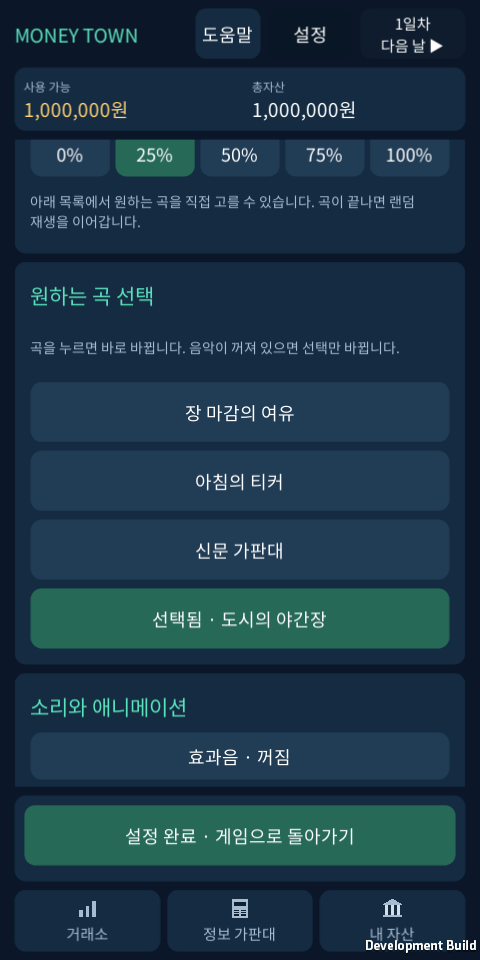

원본은 `build/ui-verification-796d80347c2841b295da70ee8f7458af/31-music-selection.png`입니다. UI 220개 검사를 통과한 실제 Player 캡처이며 공개 이미지의 SHA-256이 원본과 같습니다.

<strong>v0.23.0 배경음악 — 원곡 4곡 랜덤 재생</strong>

현재 곡 제목과 ‘다음 곡’을 배경음악 카드에서 확인합니다. 네 곡을 모두 한 번씩 들려준 뒤 다시 섞고, 한 바퀴가 바뀌어도 같은 곡이 연속으로 나오지 않습니다. 음소거 중 다음 곡을 골라도 음악이 자동으로 켜지지 않습니다. [4곡 듣기·제작 자료](music-assets.md)

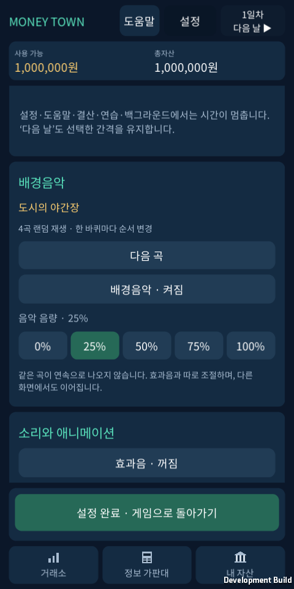

원본은 `build/ui-verification-db7a60882e9c444ab8f47b9bd4f7ecb1/30-music-playlist.png`입니다. UI 209개 검사를 통과한 실제 Player 캡처이며 공개 이미지의 SHA-256이 원본과 같습니다.

<strong>v0.22.0 배경음악 — 장 마감의 여유</strong>

상단 설정의 배경음악 카드에서 음악을 켜고 끄거나 음량을 조절합니다. 기본은 켜짐·25%이며 아래 효과음 설정과 독립적으로 동작합니다. [원곡 듣기](../unity/Assets/Resources/Audio/town-lounge.wav) · [음악 제작 자료](music-assets.md)

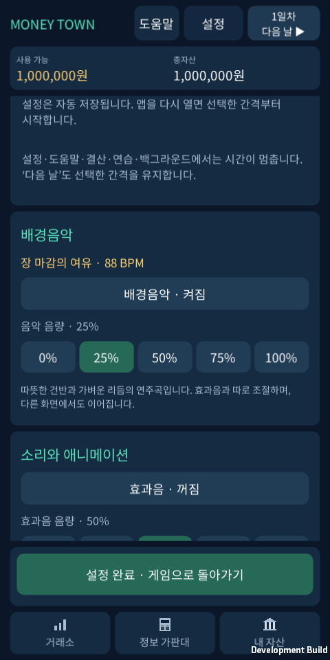

원본은 `build/ui-verification-29772d8c363b4cb491beebb2e2362de9/29-music-settings.png`입니다. UI 195개 검사를 통과한 실제 Player 캡처이며 공개 이미지의 SHA-256이 원본과 같습니다.

<strong>v0.21.0 소리와 애니메이션 설정</strong>

상단 설정에서 아래로 스크롤하면 효과음 켜기/끄기, 다섯 단계 음량, 동작 줄이기와 미리듣기를 사용할 수 있습니다. [원본 효과음 모음](../assets/audio/preview.wav)

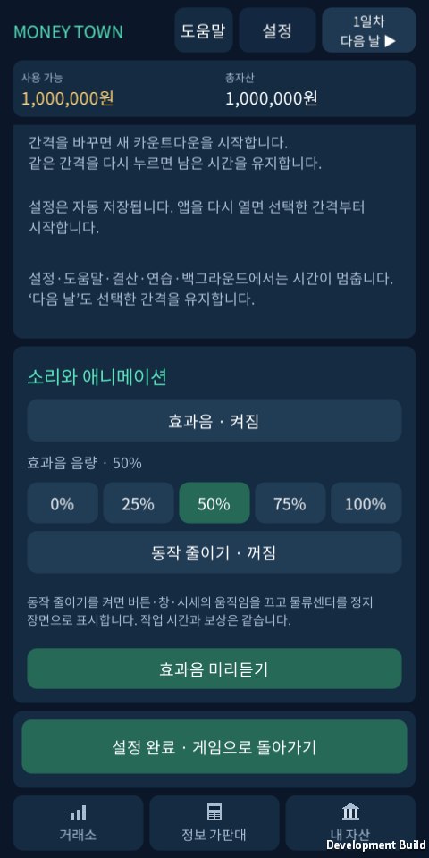

원본은 `build/ui-verification-98d9b91da0c045e0a59b261dcbe27479/28-feedback-settings.png`입니다. UI 178개 검사를 통과한 실제 Player 캡처이며 공개 이미지의 SHA-256이 원본과 같습니다.

<strong>v0.20.1 가격 조정 — 기존 진행의 총자산 보존</strong>

내 자산의 진행 관리에서 조정 당시 총자산과 정수 주식으로 바꾸고 남은 현금 정산액을 확인합니다. 실제 사용자 저장이 아닌 검증용 보유 주식 데이터입니다.

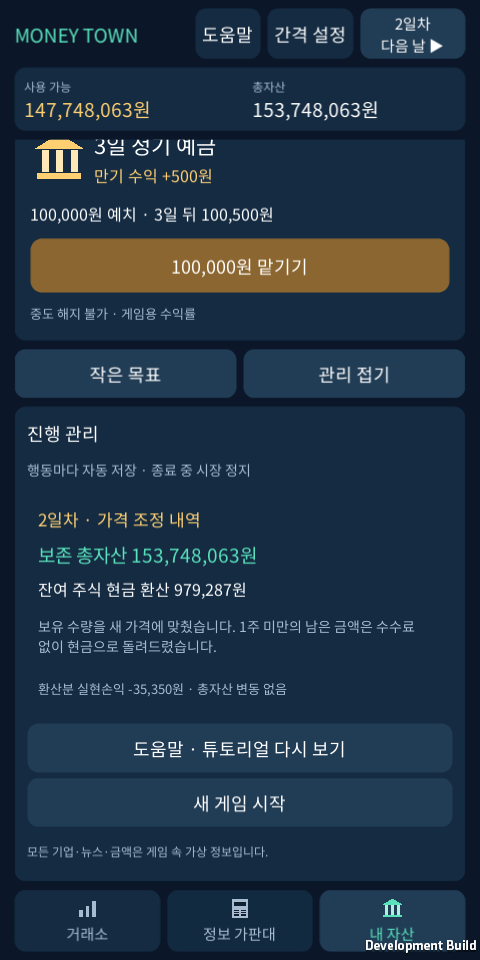

원본은 `build/ui-verification-91f25d9eebd242b49f1f439251e88d6b/27-price-migration.png`입니다. 해당 실행은 UI 133개 검사를 통과했고 공개 이미지의 SHA-256이 원본과 같습니다.

<strong>거래소 — 차트와 주문</strong>

최근 주가·다음 갱신까지 남은 시간·내 보유 주식·주문 영역을 한 화면에서 봅니다.

<strong>정보 가판대 — 봉인 정보를 고르는 순간</strong>

기업과 사건을 알기 전에 등급·신뢰도·가격·정보의 특징으로 판단합니다.

<strong>내 자산 — 포트폴리오와 다음 투자</strong>

거래·결산 기록, 물류센터 알바, 정기 예금을 확인합니다.

<strong>기업 분석 — 구매한 기사 읽기</strong>

매체를 닮은 지면에서 요약·현장 기록·사업 현황·검증 자료를 읽습니다. 아래는 스크롤 기사 상단입니다.

<strong>다음 날 브리핑 — 원인과 주가 결과</strong>

결산과 새날 개장 상황, 주요 변동 원인을 전체 화면 창으로 보여 줍니다.

<strong>물류센터 — 하루의 노동으로 마련하는 자금</strong>

상자를 옮기는 애니메이션의 한 장면입니다. 작업 후 다음 날 결산으로 넘어갑니다.

<strong>+10주 누적 — 수수료 포함 금액 확인</strong>

기본 1주에서 ‘+10주’를 두 번 눌러 21주를 선택했습니다. 이 상태에서 매수를 누르면 21주를 구매합니다.

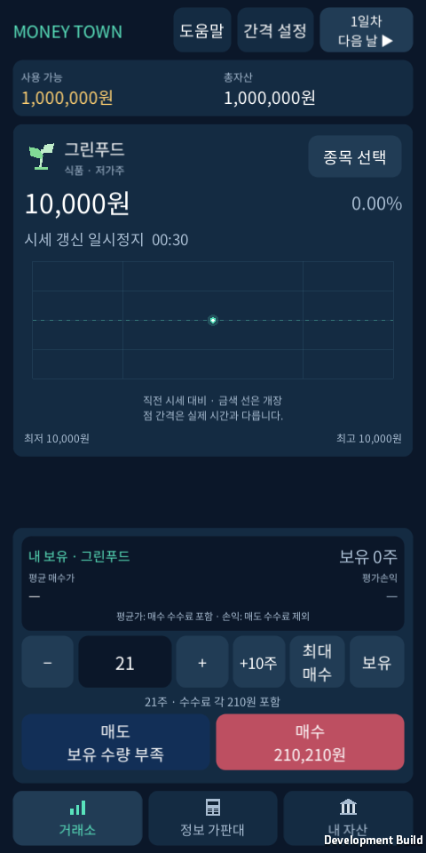

<strong>가격대별 종목 — 저가 종목에서 고가 종목으로</strong>

현재가가 낮은 순서로 기업을 비교합니다. 새 게임의 초기 100만원으로 저가·중가 6기업에 투자할 수 있습니다.

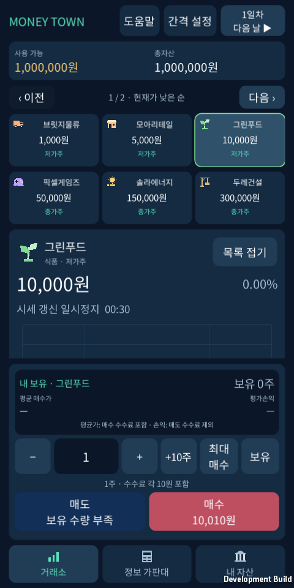

자금이 부족한 고가 종목은 수수료를 포함해 더 필요한 현금을 표시합니다.

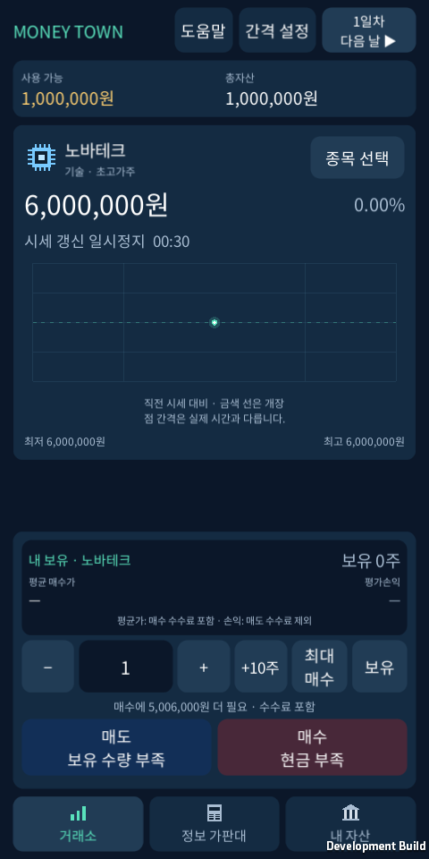

## v0.20.0 기본 화면 촬영 정보

| 항목 | 값 |
| --- | --- |
| 버전 | 0.20.0 |
| 플랫폼 | Windows / 격리된 Unity 검증 Player |
| 해상도 | 480×960 PNG |
| 검사 결과 | 이번 촬영 실행의 UI 129개 검사 통과 |
| 저장 | 새 임시 데이터, 본게임 저장·설정 미사용 |
| 편집 | 없음. `Development Build` 표시를 포함한 원본 |
| 배너 | `assets/branding/banner.svg`는 별도 제작한 벡터 일러스트 |

원본 실행 결과는 로컬 `build/ui-verification-4a69cbd08c224dc18c98717699ffdf4f/`에 있습니다. README용 파일은 원본과 SHA-256이 같은지 확인해 복사했습니다. 캡처를 다시 만드는 명령은 [개발 가이드](development-guide.md#검사와-실제-화면-캡처)에 있습니다.

| 공개 이미지 | 원본 캡처 이름 |
| --- | --- |
| `exchange.png` | `03-intraday.png` |
| `information.png` | `23-clean-information.png` |
| `portfolio.png` | `22-clean-assets.png` |
| `company-report.png` | `10-new-company-report.png` |
| `daily-briefing.png` | `12-opening-news.png` |
| `warehouse.png` | `19-warehouse-shift.png` |
| `ten-shares.png` | `24-ten-shares.png` |
| `price-tiers.png` | `25-price-tiers.png` |
| `expensive-stock.png` | `26-expensive-stock.png` |

Android 실기기 실행은 아직 검증하지 않았습니다. 이 갤러리는 Android 기기에서 촬영한 것으로 표시하지 않습니다.
